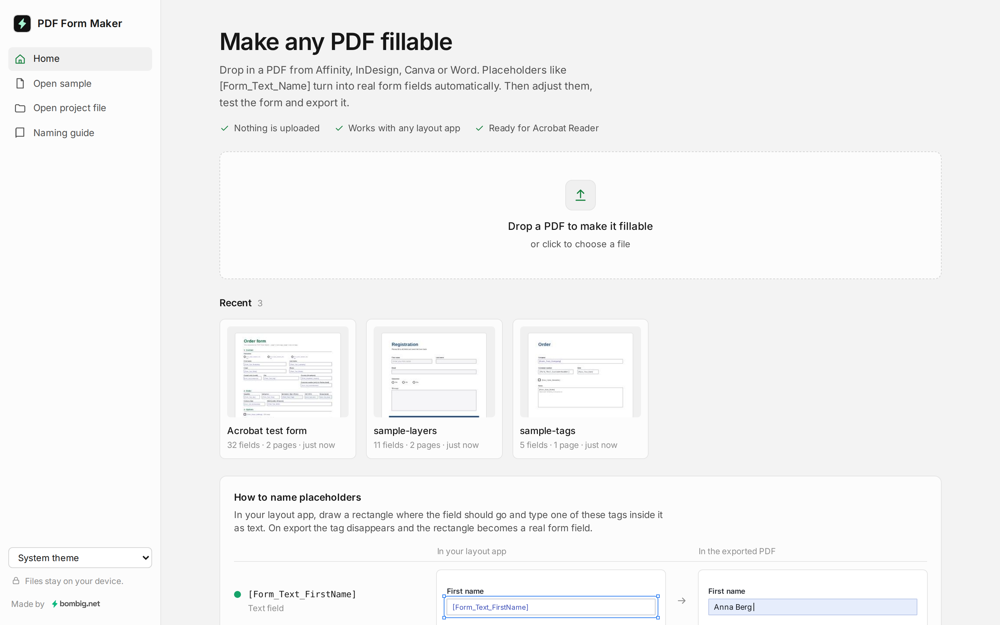
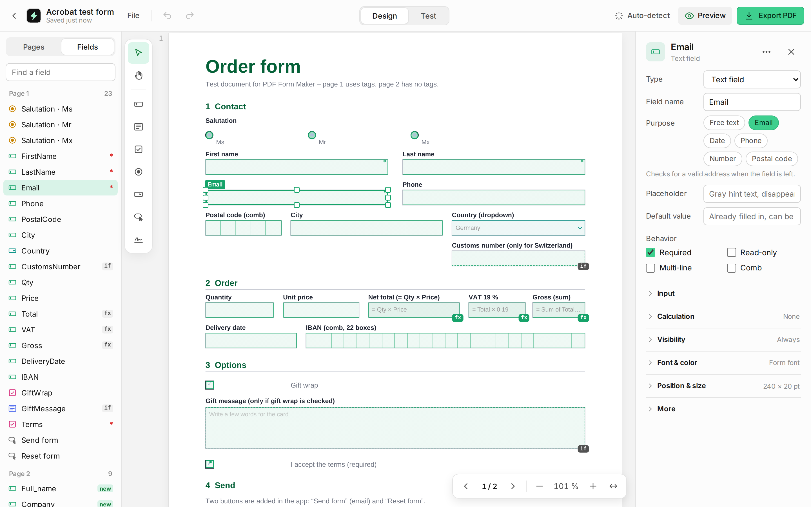

# PDF Form Maker

A web app that turns an ordinary PDF into a **fillable PDF form (AcroForm)**. Placeholders in your layout automatically become form fields based on a naming convention, and PDFs without any preparation get field suggestions from empty boxes and lines. A visual editor then lets you review, adjust and add fields.

**Try it: [bombig-net.github.io/pdf-form-maker](https://bombig-net.github.io/pdf-form-maker/)**

The app works with PDFs from any program, e.g. Affinity, InDesign, Illustrator, Canva, Word or LibreOffice. All processing happens **in the browser**: no files are uploaded and there is no server infrastructure.





## How fields get into the document

There are four ways, and you can combine them freely.

**1. Text tag in the layout (works with any PDF).** Draw a rectangle where the field should go and type a tag inside it as text:

| Tag | Result |
| --- | --- |
| `[Form_Text_FieldName]` | Single-line text field |
| `[Form_Area_FieldName]` | Multi-line text field |
| `[Form_Check_FieldName]` | Checkbox |
| `[Form_Radio_Group_Value]` | Radio button; same group = one choice |
| `[Form_Dropdown_FieldName]` | Dropdown (options are set in the editor) |

The smallest rectangle around the tag becomes the field, and the tag itself is hidden on export. For checkboxes and radio buttons the tag may also sit right next to the box.

**2. Layer name.** If your app exports layers as PDF layers (optional content groups), you can instead put the rectangle on a layer named after the tag. Whether and how layers are exported depends on the app and its export settings. When in doubt, the text tag is the safe choice.

**3. Automatic suggestions (no preparation).** For PDFs without tags, “Suggest fields” looks for empty boxes, underlines, runs of underscores or dots, and checkbox squares, and names each field after its label. Panels around other boxes, underlined headings and table grids are ignored. Suggestions are marked as such and can be undone in one step.

**4. Manually in the editor.** You can also draw fields directly on the page, e.g. for scanned documents.

Text that already sits inside a placeholder, such as “Enter your name”, does not stay as static text under the field. It is hidden and carried over into the form field as gray **ghost text**.

Existing form fields are kept, so an exported form can be opened again and edited further.

## Features

**Fields**

- Text fields, text areas, checkboxes, radio groups, **dropdowns** and **buttons** (reset the form or **send it by email** with the filled PDF attached).
- **Comb fields:** one box per character, e.g. for an IBAN or a postal code.
- **Calculated fields:** sum, product, average, minimum or maximum of other fields, or a formula such as `Quantity * Price * 1.19`.
- **Conditional fields:** shown only when a checkbox is checked or a radio group or dropdown has a certain value.
- **Smart Fields:** email, date (with a date picker in Acrobat mobile), phone, number, postal code.
- **Regional formats** per form: Europe (default), Switzerland, United Kingdom or United States.
- **Address block:** name, street, postal code, city, email and phone as ready-made fields with one click.

**Editor**

- Draw, move, resize, delete and duplicate fields; undo/redo.
- **Multi-selection:** shift-click or selection rectangle; move, align, distribute evenly, match width/height and set properties together.
- **Copy and paste** fields (⌘/Ctrl C/V), also onto other pages.
- **Field names from labels:** a field drawn next to “First name” is automatically named `First_name`.
- **Font matching:** font family (sans/serif/mono), size and color are taken from the text inside the field or from the label. Custom TTF/OTF fonts can be embedded.
- **Smart Align:** snapping to the edges of other fields and to lines in the template (hold Alt to bypass snapping).
- **Automatic tab order** from top left to bottom right, also on rotated pages.
- **Smart Contrast:** the input color automatically turns light on dark backgrounds.
- **Page management:** rotate, reorder (drag), delete, append more PDFs.
- **Same field name on several pages:** keep them in sync or separate them (suffix `_S1`, `_S2` …).

**Checking and saving**

- **Test mode** (⌘/Ctrl E): fill in the form right in the app, including tab order, ghost text, format validation, calculations, conditional fields and synced fields.
- **Preflight before export:** warnings about overlapping fields, fields beyond the page edge, very small fonts, name conflicts, invalid formulas, broken visibility rules and more.
- **Recent forms:** every form you open is saved automatically in your browser (IndexedDB) and appears on the home screen.
- **Project files** (`.formmaker`): save a form with all fields and settings as one file to back it up or pass it on, and open it again from the home screen.

**App**

- **Light and dark theme** following the system setting, or chosen manually on the home screen.
- **Installable:** add it to the home screen on iPhone, iPad or Android, or install it from Chrome on the desktop.
- **Touch:** pinch-to-zoom and large handles on iPad, properties as a bottom sheet on phones; Ctrl/⌘ + mouse wheel or trackpad on desktop.

## Regional formats

| Region | Date | Number | Postal code |
| --- | --- | --- | --- |
| Europe (default) | 31.12.2026 | 1.234,56 | 4–5 digits |
| Switzerland | 31.12.2026 | 1'234.56 | 4 digits |
| United Kingdom | 31/12/2026 | 1,234.56 | SW1A 1AA |
| United States | 12/31/2026 | 1,234.56 | 12345 or 12345-6789 |

The region is set in the form panel (no field selected) and is saved with the form.

## Limitations and technical notes

- **Acrobat features:** validation, ghost text behavior, calculations, conditional fields and email buttons use Acrobat JavaScript. They work in Adobe Acrobat and Reader (desktop and mobile). Other viewers (e.g. macOS Preview, browsers) ignore them: calculated fields stay empty and conditional fields stay hidden.
- **Input fonts:** when typing into a form field, the PDF reader needs the complete font. Most apps only embed the characters actually used. The app therefore maps to Helvetica, Times or Courier (incl. bold/italic) or fully embeds an uploaded font.
- **Static text** is not deleted but made invisible with text render mode 3, so the template's layout and spacing stay unchanged.
- **Detection and suggestions** need real text and vector shapes in the PDF. In scans or text converted to outlines, fields have to be drawn manually.
- **Encrypted PDFs** must be exported without password protection first.
- **Recent forms** are stored per browser and device. Clearing site data removes them; exported PDFs and project files are not affected.

## Development

```bash
npm install
npm run dev          # development server
npm test             # tests (detection, suggestions, export, logic, geometry, formats, performance)
npm run test:e2e     # browser tests with Playwright (first run: npx playwright install chromium)
npm run build        # web app in dist/
npm run build:single # a single HTML file in dist-single/
```

Requires Node.js 20 or newer. The sample PDFs in `src/assets/` and the app icons in `public/` are generated by `scripts/make-samples.mjs` and `scripts/make-icons.mjs` (automatically before `dev`, `build` and `test`).

### Structure

| Path | Contents |
| --- | --- |
| `src/pdf/tokenizer.ts`, `src/pdf/interpreter.ts` | Content stream parser: layers, paths, text, fonts, colors |
| `src/pdf/analyze.ts` | Analysis of a PDF (pdf-lib + pdf.js) |
| `src/pdf/detect.ts` | Naming convention, field detection, font and color mapping |
| `src/pdf/suggest.ts` | Field suggestions for PDFs without tags |
| `src/pdf/logic.ts` | Formulas, calculations, visibility rules, email action |
| `src/pdf/export.ts` | AcroForm export, hiding text, assembling pages, tab order, scripts |
| `src/util/locale.ts` | Regional formats for date, number and postal code |
| `src/ui/` | Home screen, recent forms, project files, editor: viewer, page rail, properties, multi-selection, test mode, preflight |
| `src/styles.css` | Design tokens (light and dark) and editor styles |
| `src/home.css`, `src/features.css`, `src/brand.css` | Home screen, editor extensions, “Made by” link |
| `test/` | Vitest tests |
| `e2e/` | Playwright browser tests |

### Deployment

The app is deployed to GitHub Pages on every push to `main`: [bombig-net.github.io/pdf-form-maker](https://bombig-net.github.io/pdf-form-maker/).

The workflow templates live in `docs/workflows/`:

- `ci.yml` runs the tests, the build and the browser tests on every push and pull request.
- `pages.yml` builds the app on every push to `main` and publishes it to GitHub Pages.

To set this up in a fork:

1. Copy both files to `.github/workflows/` (in the GitHub web interface: “Add file → Create new file”, enter `.github/workflows/ci.yml` as the name and paste the content; same for `pages.yml`).
2. Under **Settings → Pages → Build and deployment → Source**, choose **GitHub Actions**.
